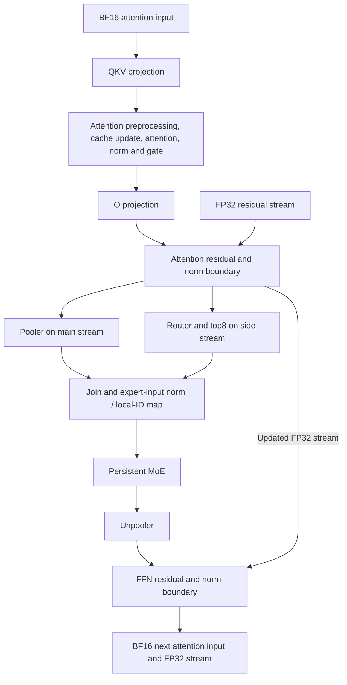

# Retained Decode dependency and boundary map

CPU source inspection of D9 only, bound to
d9fe7558624a1f070bbacb493b94302e90ff9bf77cdd8d4239f9d7a83ab39988.
No new runtime implementation, GPU job, profiler timeline or speedup claim.
The audit records final Python function bindings, avoiding superseded prepare
and helper definitions in this assembled source.

The parallel pooler/router branches describe the non-fused path. Eligible
M9..32 instead uses the retained fused pooler/router, followed by top8.
The source-level join is explicit before expert-input preprocessing. This
diagram shows dependencies and intended stream concurrency; it is not a
measurement of exposed latency or overlap effectiveness.

| Regime | Router/pooler path | Unpooler/boundary path |
| --- | --- | --- |
| M1..8 | Original FP32 router input/weights, fused router when available; pooler concurrent | Existing1024-column local unpooler plus implicit zero tail, full8192 norm domain |
| M9..32 | Existing fused pooler/router when prepared; otherwise main/side branches | Full unpooler and existing fused FFN boundary |
| M>32 | Native eligible wide router or BF16 hi+lo fallback with FP32 accumulation; pooler concurrent | Full unpooler and existing fused FFN boundary |

Already retained: native attention's prologue/cache/norm/gate operations,
attention residual/pre-FFN norm boundary, expert-input norm/local-ID mapping,
MoE routing/both GEMMs/SwiGLU/output norm/reduction, small zero-tail FFN
boundary, and full FFN residual/next norm boundary. These are not new fusion
proposals. The MoE CUDA also already uses register/shared WGMMA: proposing
register operands to avoid a dequantized weight shared-memory store would
describe the existing implementation.

Remaining projection handoffs are real materializations, but a tiled GEMM
does not own the complete output row needed by RMSNorm. A proposed fusion
must retain BF16 branch rounding, assemble complete FP32 statistics with
correct synchronization, and charge any partial reduction traffic or lost
parallelism. A cluster that covers fewer SMs can lose more projection time
than it saves in launches. No profitable configuration follows from the
source map alone.

The exact retained benchmark/profile reconstruction is in
results/retained-load-opportunities-20261029/. Each Decode load is
46*sliding+16*full; the twelve rows are not equally weighted loads. Profiler
kernel sums are separate observations, not critical-path fractions. The
existing conditional savings screen shows that a3% track gain restricted
to M32/128/256 requires average layer savings of about11.36/16.36/21.48us
respectively if those three loads improve equally. This charges all added
work and lost overlap. It is a dilution identity, not a forecast.

The rejected MoE factor trial will not be transferred. Source package307dd791
remains CPU-only preparation headroom: lossless literal packaging, two
unreachable dense-router factory bypasses and the unread root RoPE table
removal. It changes no timed function and has no measured preparation gain.
Use it only alongside a justified runtime candidate; do not spend a check
merely to retime cleanup.

Next selection requires a distinct observed operation/transfer that can be
removed, a conservative weighted load-time bound, numerical/materialization
proof, resource and replay model, and actual-execution markers. Until that
packet exists, preserve D9 and conserve Decode quota. Attention full-context
regimes remain a candidate evidence source; their substantial saved kernel
durations do not by themselves establish a better implementation.

Reproduce: `python experiments/prepared/audit_decode_boundaries.py`.
